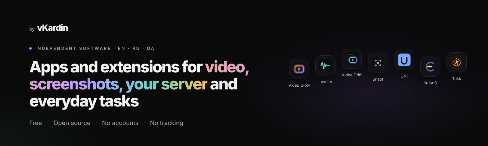
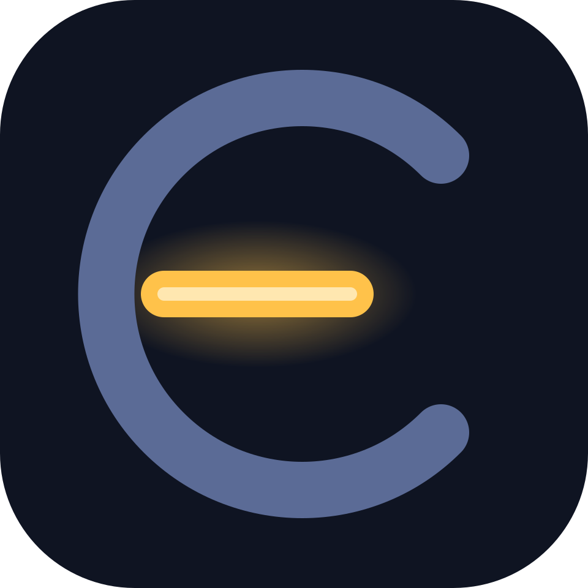

  <a href="https://vkardin.github.io/"><b>vkardin.github.io</b></a> ·
  <a href="https://vkardin.github.io/ru/">Русский</a> ·
  <a href="https://vkardin.github.io/uk/">Українська</a> ·
  <a href="https://www.youtube.com/@vKardin">YouTube</a> ·
  <a href="https://www.tiktok.com/@vkard1n">TikTok</a>

I make small, focused tools that respect you. Every project is **free**, **MIT-licensed**, works **without accounts or cloud**, and **collects no data**. Interfaces and docs come in English, Russian and Ukrainian.

## Projects

<table>
  <tr>
    <td width="72" align="center"></td>
    <td><b><a href="https://github.com/vkardin/video-glow">Video Glow</a></b> · browser extension Ambient light in the colours of the picture around any HTML5 video. YouTube, Twitch, fullscreen. <a href="https://chromewebstore.google.com/detail/bjgbalkabocifimhnhbcnomeknpbhkea">Chrome</a> · <a href="https://addons.mozilla.org/firefox/addon/video-glow/">Firefox</a> · <a href="https://vkardin.github.io/video-glow/">Website</a></td>
  </tr>
  <tr>
    <td align="center"></td>
    <td><b><a href="https://github.com/vkardin/video-drift">Video Drift</a></b> · browser extension Pops any web video into a floating window with subtitles, remembers where you stopped and saves timestamped notes. <a href="https://addons.mozilla.org/firefox/addon/video-drift-floating-player/">Firefox</a> · <a href="https://github.com/vkardin/video-drift/releases">Download</a> · <a href="https://vkardin.github.io/video-drift/">Website</a></td>
  </tr>
  <tr>
    <td align="center"></td>
    <td><b><a href="https://github.com/vkardin/leveler">Leveler</a></b> · browser extension Evens out the loudness of any video: louder dialogue, softer explosions, volume boost up to 400%. <a href="https://chromewebstore.google.com/detail/phbjpipnbhffcegccfbbfabbhmgaelko">Chrome</a> · <a href="https://addons.mozilla.org/firefox/addon/leveler/">Firefox</a> · <a href="https://vkardin.github.io/leveler/">Website</a></td>
  </tr>
  <tr>
    <td align="center"></td>
    <td><b><a href="https://github.com/vkardin/snapt">Snapt</a></b> · desktop app (Rust) + browser extension Fast, lightweight screenshot tool for Windows, macOS and Linux. Select, annotate, copy. <a href="https://vkardin.github.io/snapt/#download">Download</a> · <a href="https://addons.mozilla.org/firefox/addon/snapt-screenshots-images/">Firefox extension</a> · <a href="https://vkardin.github.io/snapt/">Website</a></td>
  </tr>
  <tr>
    <td align="center"></td>
    <td><b><a href="https://github.com/vkardin/uni-homebot">UNI</a></b> · Telegram bot + Mini App (Python) Your home server in Telegram: apps, monitoring, news and repairs. Self-hosted, installs with one command. <a href="https://github.com/vkardin/uni-homebot/releases/latest">Download</a> · <a href="https://vkardin.github.io/uni-homebot/">Website</a></td>
  </tr>
  <tr>
    <td align="center"></td>
    <td><b><a href="https://github.com/vkardin/koly">Коли Є</a></b> · Windows widget, Android app in development Power outage schedules for every region of Ukraine: what is on now, a countdown to the next change, today and tomorrow. Works offline. <a href="https://github.com/vkardin/koly/releases/latest">Download</a> · <a href="https://vkardin.github.io/koly/">Website</a></td>
  </tr>
  <tr>
    <td align="center"></td>
    <td><b><a href="https://github.com/vkardin/tukk">Tukk</a></b> · Android app, in development Phone gestures for everyday actions: shake for the flashlight, flip face down for silence, tap the back to pause music. <a href="https://vkardin.github.io/tukk/">Website</a></td>
  </tr>
</table>

## Support

These tools are free and stay free. If one of them saves you time, you can support further development:

Crypto (USDT, BTC, ETH, SOL) is listed on every project page, for example [Video Glow → Donate](https://vkardin.github.io/video-glow/#donate). A ⭐ on GitHub helps too: it makes the projects easier for other people to find.

Found a bug or have an idea? Open an issue in the project's repository.
